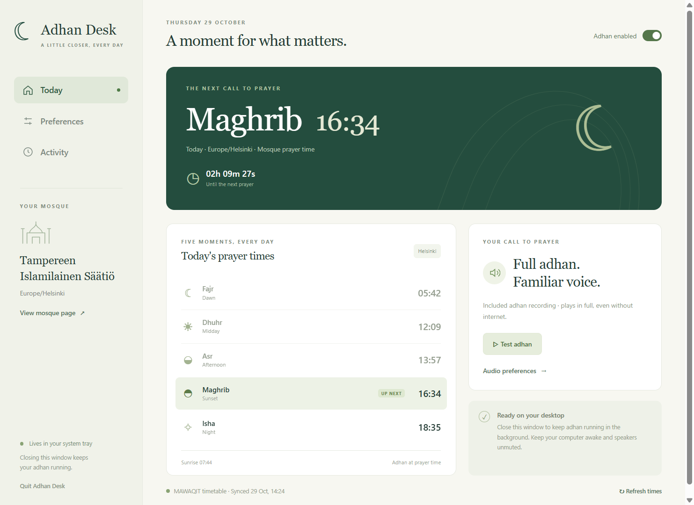

# Adhan Desk

Your mosque's prayer times and the full adhan on your desktop. Adhan Desk runs in the background on Windows, with macOS and Linux build targets, and plays a bundled recording when each selected prayer begins.

Hervanta's **Tampereen Islamilainen Säätiö** is the initial mosque. Paste another supported MAWAQIT mosque URL to use your own community's timetable.



## Get started

Use a preview installer from [Releases](https://github.com/kamran-jabbar/adhan-desk/releases) when available, or [build from source](#run-from-source).

1. Open the app and check the mosque name, date and timezone.
2. Use **Test adhan**, adjust the volume and confirm that your speakers are audible.
3. Select the prayers you want. A fresh installation enables all five prayers and includes the full local recording, so no audio download is required.
4. Check **Start at login** and **Keep computer awake** in settings. Login startup is enabled on the first launch of a packaged app; keep-awake is optional. Existing saved preferences are preserved.
5. Optionally import a separate **Fajr recording** and enable **Unmute for adhan** if you want the app to adjust system sound during playback.

Closing the main window leaves the app running in the system tray or menu bar. The tray menu can reopen the window, pause automatic adhan, stop playback or quit. **Quit** stops the scheduler.

On macOS, copy the app into Applications before its first launch. On Linux, put the AppImage in a stable location and make it executable before launching it; moving it later can invalidate its login-startup path. Linux tray and XDG login-startup behavior depend on the desktop environment.

## Features

- Mosque-published Fajr, Dhuhr, Asr, Maghrib and Isha times, using the mosque's timezone.
- Full local adhan playback, with a bundled recording of approximately 87 seconds.
- Custom local recording import and optional configurable YouTube playback.
- Separate imported Fajr recording, with the regular recording used when none is selected.
- Per-prayer switches, volume, pause, stop, next-prayer countdown and activity log.
- Optional system unmute and a minimum 35% system output level during adhan, with previous sound settings restored afterward.
- Background tray operation, login startup and optional idle-sleep prevention.
- Up to seven dated timetable days cached for short internet outages, with duplicate-playback protection.

The included recording is **“The Adhan - Muslim Call to Prayer - Aaqib Azeez.mp3” by Atcovi**, from Wikimedia Commons, under **CC BY-SA 4.0**. It is distributed unchanged. See [audio attribution and license](docs/AUDIO-LICENSE.md).

You can import a separate full Fajr recording containing the additional Fajr wording. No separate Fajr recording is bundled; until one is imported, Fajr uses the regular recording. Importing a personal recording does not grant redistribution rights to it.

Import MP3, WAV, Ogg, M4A or FLAC to use another full recording. Codec support depends on Electron and the operating system. YouTube mode opens a visible embedded player and needs an internet connection and an embeddable video. The app reports playback restrictions and connection failures; local audio is the dependable option for automatic playback.

## Reliable playback

The computer must be powered on, logged in and awake, with Adhan Desk running and an audible sound output. Keep-awake requests help prevent idle application suspension while enabled; they do not power on a computer, wake it from shutdown or override every power policy. The screen can turn off while audio remains available.

**Unmute for adhan** is off by default in a fresh public installation. When enabled, the app attempts to unmute the system output and raise its volume to at least 35% for playback. It keeps a snapshot of the previous mute and volume settings and restores them when playback finishes or is stopped. The app's own playback-volume control still applies. This temporarily changes the system output level for other computer sounds too.

System sound control uses Windows CoreAudio, built-in `osascript` on macOS, or `pactl`/`wpctl` on supported Linux audio setups. On macOS, restoration applies to the output that is default at restoration time; avoid switching outputs during playback if exact restoration matters. Control failures are reported and restoration is best effort. The option cannot turn on physical speakers, reconnect a device, undo a hardware mute or guarantee that a separately muted app/session is audible.

Prayers more than 90 seconds late are skipped after resume. The app records an attempt before playback to prevent duplicate calls after a crash or restart. If audio fails, check the activity log and run an audio test; the app does not repeatedly retry the same prayer.

## Prayer times and offline use

The default source is the [Hervanta mosque page on MAWAQIT](https://mawaqit.net/en/m/hervanta-new-mosque-tampere-33720-finland). Adhan Desk reads the public page's embedded `confData.calendar` JSON. This is a public HTML adapter, not a documented official MAWAQIT API. Page changes may require an adapter update. The project is independent of MAWAQIT and the mosque.

The five published adhan times are preserved. Sunrise is excluded; Jumua and iqama do not create extra automatic calls. Special seven-column Sabah/Imsak calendars currently produce an explicit unsupported-format error.

Timetables refresh at launch, every six hours, after resume and when the mosque-local date changes. Failed refreshes retry after 1, 2, 4, 8 and then 15 minutes, capped at 15 minutes. Each successful refresh saves up to seven dated days, stopping at December 31 because the source does not label the calendar year. A new-year refresh is required.

Local audio works offline while a saved timetable covers the current date. Expired dates are never rolled forward and replacement times are never invented. YouTube playback still needs internet even when times are cached.

## Run from source

Install Node.js 24 or newer. The reproducible dependency setup uses pnpm 11.25.0 and the checked-in lockfile:

```sh
pnpm install --frozen-lockfile
pnpm test
pnpm start
```

npm can also be used:

```sh
npm install
npm test
npm start
```

There is no checked-in npm lockfile, so npm resolves transitive dependencies independently. Electron 45.1.0 and electron-builder 26.18.0 are pinned. Running from source does not register automatic login startup. No account or hosted application backend is required.

## Build and release

Build on the matching operating system. Files are written to `dist/`:

| Platform | Local command | Output |
| --- | --- | --- |
| Windows | `pnpm run build:win --publish never` | x64 NSIS installer |
| macOS | `pnpm run build:mac --publish never` | DMG for the build host's architecture |
| Linux | `pnpm run build:linux --publish never` | AppImage for the build host's architecture |

With npm, use `npm run build:win -- --publish never` and the corresponding macOS/Linux script. `npm run pack:win` creates an unpacked Windows folder; keep its files together.

The [GitHub Actions workflow](.github/workflows/build.yml) tests and builds Windows x64, macOS x64 and arm64, and Linux x64. A push to `main` creates a **preview prerelease** named `v<package.json version>` only after every matrix build succeeds and only if that release does not already exist. It attaches the installers and SHA-256 checksums. Pull requests and manual workflow runs build artifacts without publishing a release. Bump `package.json` to publish a subsequent version; existing releases are left unchanged.

Installers are unsigned and macOS builds are unnotarized. Windows installation, login startup, local playback and scheduling have been exercised. Every release still needs a fresh packaged-app smoke check. macOS and Linux speaker output, tray behavior and login startup require manual checks on those systems; successful CI packaging alone does not verify them.

## Contributing

The application uses MVC boundaries so timetable providers, settings, desktop integration and UI changes can be maintained independently. Start with [architecture and change guides](docs/ARCHITECTURE.md), and see [product scope and roadmap](docs/PRODUCT.md).

Run `pnpm test` before submitting a change. Include a concrete reproduction for bug reports and distinguish an expired timetable, source failure and audio-output failure. Avoid committing personal app profiles, imported recordings or private mosque/account information.

Settings, imported audio, recent logs and the dated cache live in Electron's per-user application data directory. Requests go to the selected public MAWAQIT page and, only in YouTube mode, YouTube's player resources. There is no application analytics service.

## Support

If Adhan Desk is useful to you, you can [support Kamran's work on Buy Me a Coffee](https://buymeacoffee.com/kamranjabbar). Contributions help maintain Adhan Desk and build future practical projects. Support is optional; the app and all its features remain free.

## License

Application source: [MIT](LICENSE). Bundled default audio: [CC BY-SA 4.0 with attribution](docs/AUDIO-LICENSE.md). MAWAQIT data, branding, external videos and imported recordings retain their respective rights. Personal recordings are not included in this repository or its public installers.
