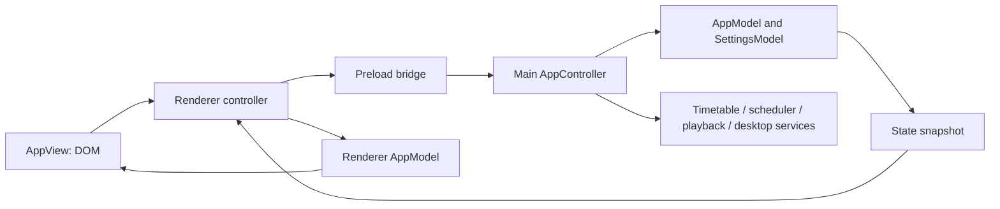

# Architecture and maintainer guide

Adhan Desk uses MVC in both Electron's main process and the renderer. Models own state and validation; controllers coordinate actions; views render state and collect input. Services provide timetable, scheduling, audio and operating-system capabilities.

## Layout

```text
src/
  main/
    main.cjs                         Application bootstrap
    controllers/AppController.cjs   Lifecycle, refresh, scheduling and IPC orchestration
    models/AppModel.cjs              Persistent state, logs and derived event cache
    models/SettingsModel.cjs         Defaults and validated setting changes
    services/mawaqit.cjs             Public MAWAQIT adapter
    services/scheduler.cjs           Timezone-aware event construction and due-event selection
    services/server.cjs              Loopback UI and local-audio delivery
    services/PlaybackService.cjs     Player lifecycle and playback reporting
    services/DesktopService.cjs      Tray, login startup and power integration
    preload.cjs                     Narrow renderer-to-main bridge
    player-preload.cjs              Narrow player-to-main bridge
  renderer/
    renderer.js                     UI bootstrap
    models/AppModel.js              Renderer snapshot state
    views/AppView.js                DOM rendering and controls
    controllers/AppController.js   User actions, bridge calls and state updates
    player.js                       Local audio / YouTube player
assets/
  adhan.mp3                         Unchanged CC BY-SA 4.0 default recording
  tray.png                          Tray icon
  icon.png                          Application icon
  icon.svg                          Editable icon source
```

Main-process modules use CommonJS. Renderer MVC modules use browser ES modules. The application has no third-party runtime Node dependency beyond Electron; electron-builder is a development/build tool.



## Boundaries

The main controller owns application orchestration: refresh timing and retry backoff, scheduler ticks, IPC handlers and response to lifecycle events. It coordinates services rather than implementing DOM behavior or embedding provider parsing.

The main app model stores settings, the dated timetable, played-attempt IDs, recent logs and local recording state. It also owns the derived event cache so repeated UI snapshots do not rebuild the same schedule. The settings model validates complete candidate changes before state is committed. A settings change that affects the OS or player is applied through the appropriate service.

The scheduler is independent of Electron. It builds explicit prayer events in the mosque's timezone, selects due events and applies the late-playback window. Provider adapters supply wall-clock prayer times; they do not decide when audio starts.

The renderer controller receives snapshots through the preload bridge, updates its model and asks the view to render. The view owns DOM details. Renderer code does not read files, configure login startup or fetch mosque pages directly.

The playback window uses a separate, restricted bridge. The local server binds to the local machine to serve the interface and the selected audio; it is not a hosted backend. Keep IPC sender checks, URL validation, context isolation, disabled Node integration and the restricted player boundary intact when extending the app.

## Add a timetable provider

1. Create a provider service alongside `services/mawaqit.cjs`. Keep network parsing separate from the scheduler and use dependency injection or a fetch parameter for unit tests.
2. Return the same dated timetable contract:

```js
{
  name: 'Mosque name',
  timezone: 'Europe/Helsinki',
  sourceUrl: 'https://provider.example/mosque',
  fetchedAt: '2026-10-29T10:00:00.000Z',
  days: [{
    date: '2026-10-29',
    prayers: {
      Fajr: '05:42', Dhuhr: '12:09', Asr: '13:57',
      Maghrib: '16:34', Isha: '18:35'
    },
    sunrise: '07:44'
  }]
}
```

3. Add provider selection and input validation in `SettingsModel.cjs`, then route refresh through the selected provider in the main controller.
4. Validate the provider's actual timezone, dates and time format. Preserve clear errors and dated-cache expiry. Never silently replace mosque times with another calculation method.
5. Test representative data, malformed responses, a timezone boundary, redirects/host restrictions and year rollover. Update source attribution and setup text.

The current MAWAQIT adapter parses public embedded JSON without executing the page's scripts. It restricts requests to supported HTTPS mosque pages, bounds response size and rejects unsupported calendar formats.

## Change the interface

Edit structure/styles and `views/AppView.js` for layout or presentation. Put action wiring and calls to the preload bridge in `controllers/AppController.js`; keep snapshot state in `models/AppModel.js`. Add a bridge method and a main-controller IPC handler only when the action needs a privileged capability. Validate the sender and arguments in the main process.

Manually check the timetable, settings, paused state, active playback and error state at the minimum window size. Confirm that long mosque names and readable focus states still work. A renderer-only preview cannot verify native audio, tray or login-startup behavior.

## Add a setting

1. Add its default and validation in `main/models/SettingsModel.cjs`.
2. Preserve it through app-model load/save and define how older saved profiles acquire its default.
3. Coordinate any side effect in the main controller and the relevant service. Avoid committing a setting that reports an OS action succeeded when that action failed.
4. Add the control/rendering to the view, action handling to the renderer controller and snapshot state where needed.
5. Test validation, persistence and interactions with existing settings; manually verify any desktop-specific side effect.

Login startup is enabled on first launch of the packaged app. Development launches must not register their Electron executable as a login item. Preserve a user's existing choice on subsequent launches.

## Replace or add audio

Keep redistributable recordings under `assets/` and include their license notices in the packaged file list. Preserve the title, creator, source URL, license link and modification history. Update `docs/AUDIO-LICENSE.md` and the visible audio credit together. The current default is `assets/adhan.mp3`, distributed unchanged under CC BY-SA 4.0; the code's MIT license does not replace that license.

Test the complete recording through its natural end, stop it manually, and check imported-file and missing-file behavior. Do not commit personal imported recordings, application profiles or unrelated copyrighted audio.

## Test and package

```sh
pnpm install --frozen-lockfile
pnpm test
pnpm start
```

`node:test` covers provider parsing, timezone scheduling, the local server and models without requiring an Electron UI. Native integration checks still need Electron: actual playback completion, one scheduled event, persistence/restart deduplication, close-to-tray behavior, login startup and idle-sleep settings.

For isolated development profiles, set `ADHAN_DESK_USER_DATA` to a temporary directory. `ADHAN_DESK_TEST_MODE=1` disables automatic prayer playback and mutes player windows. Use these intentionally in automated checks and do not ship test profiles in packages.

Build on each target OS with the scripts in `package.json`. After architecture or native-integration changes, test the packaged application as well as source mode. Windows uses NSIS x64; CI also builds macOS x64/arm64 DMGs and a Linux x64 AppImage. Unsigned/unnotarized builds remain preview releases.

## Release workflow

The workflow runs tests before packaging each matrix target. Pull requests and manual runs upload build artifacts. A push to `main` publishes a prerelease for `v<package.json version>` only after all matrix installers pass, attaching installers and SHA-256 checksums. It leaves an existing release unchanged and refuses to reuse an existing tag that lacks a release.

Before pushing a release change to `main`:

- Review the version in `package.json`; increment it for a new release.
- Run tests and the appropriate packaged-app smoke checks.
- Check included audio credits, package contents and absence of personal files.
- Verify release notes distinguish platform build success from manual playback/startup checks.

The build commands themselves use `--publish never`; publication belongs to the workflow's separate release job. Signing and notarization credentials are not configured.

## Primary references

- [Electron application lifecycle and login items](https://www.electronjs.org/docs/latest/api/app)
- [Electron tray](https://www.electronjs.org/docs/latest/api/tray)
- [Electron power-save blocker](https://www.electronjs.org/docs/latest/api/power-save-blocker)
- [electron-builder](https://www.electron.build/)
- [The default mosque timetable](https://mawaqit.net/en/m/hervanta-new-mosque-tampere-33720-finland)
- [Bundled recording and its license](AUDIO-LICENSE.md)
